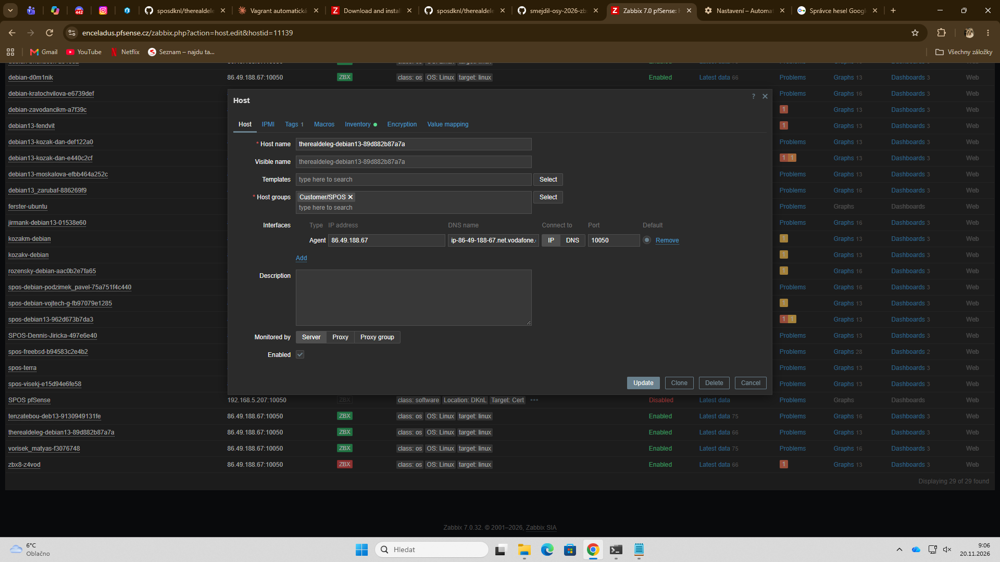
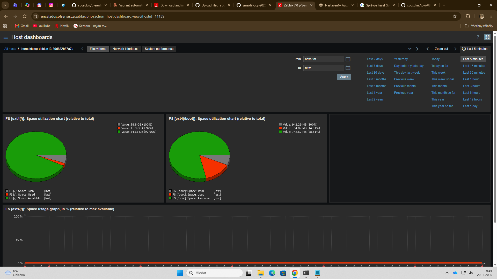

# OSY: Automatická registrace Debianu 13 do Zabbixu


Vagrant spustí virtuální stroj s Debianem 13 (`bento/debian-13`), nainstaluje na něj
Zabbix Agent 2 verze 8.0 LTS z oficiálního repozitáře Zabbixu a automaticky ho
zaregistruje na server `enceladus.pfsense.cz`.

## Postup práce

1. Vyšel jsem z `Vagrant/Vagrantfile-debian` ze šablony a upravil ho (box, provisioning).
2. Instalační skript stáhne `zabbix-release` pro Debian 13 z repozitáře Zabbix 8.0,
   aktualizuje `apt` a nainstaluje `zabbix-agent2`.
3. Konfigurační skript nastaví v `/etc/zabbix/zabbix_agent2.conf` parametry `Hostname`,
   `Server`, `ServerActive` a `HostMetadata=SPOS`, povolí a restartuje službu.
4. Název hosta se vytvoří jen jednou (prefix `therealdeleg-debian13` + 12 náhodných znaků),
   uloží se do `/var/lib/zabbix-auto-reg/hostname` a při dalším provisioningu se jen načte.
   Přežije restart VM i opakovaný `vagrant provision`. Po `vagrant destroy` vznikne nový název.
5. Registraci spouští aktivní spojení agenta se serverem, kde jsou připravena pravidla
   pro `HostMetadata=SPOS`.

## Spuštění

```
vagrant up
```

## Ověření

Uvnitř VM (`vagrant ssh`):

```
cat /var/lib/zabbix-auto-reg/hostname
zabbix_agent2 -V | head -n1
systemctl status zabbix-agent2
grep -E '^(Hostname|Server|ServerActive|HostMetadata)=' /etc/zabbix/zabbix_agent2.conf
getent hosts enceladus.pfsense.cz
timeout 5 bash -c '</dev/tcp/enceladus.pfsense.cz/10051' && echo OK
```

V Zabbixu je registrovaný host `therealdeleg-debian13-89d882b87a7a` se skupinou `SPOS`,
štítkem `class: os`, `OS: Linux`, `target: linux`:



Příchozí data z hosta (Latest data):



## Soubory

- `Vagrantfile`: Debian 13 box a automatický provisioning.
- `install-zabbix-agent2.sh`: instalace Zabbix Agent 2 8.0 z oficiálního repozitáře.
- `configure-zabbix-agent2.sh`: stálý název hosta, nastavení agenta a spuštění služby.
- `Images/`: screenshoty registrace a příchozích dat.

